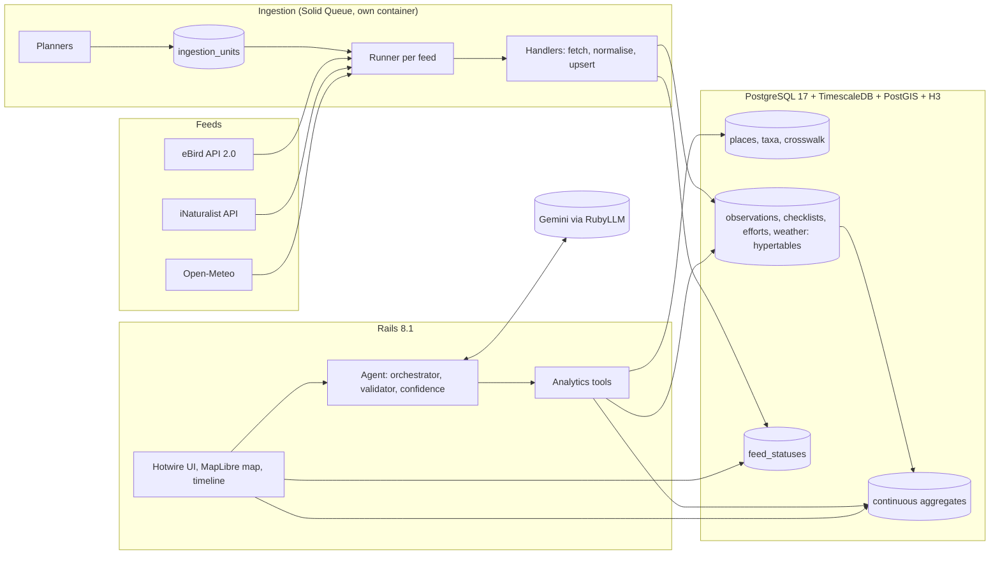

# Flyway

**Did the weather move the birds?** A natural-language interface to bird migration and night winds in eastern
Canada (Quebec, Ontario, New Brunswick, Nova Scotia, Prince Edward Island), built on three live data feeds.

- **Live demo:** https://168-138-92-191.sslip.io
- **Data status:** https://168-138-92-191.sslip.io/status
- **Place search:** https://168-138-92-191.sslip.io/places

Built as a take-home engineering challenge.

## The question

Twice a year hundreds of millions of birds cross eastern Canada, mostly at night and mostly unseen. Whether they
move on a given night depends heavily on the weather: in fall they wait for the north-west winds behind a cold
front, in spring for warm southerly flows. Flyway asks, for any place and period:

1. **What** is being reported: which species or groups are arriving or leaving?
2. **Is it a real change**, or were there simply more observers out?
3. **Did the night winds help or hinder** the birds? (An association, never a proven cause.)
4. **How sure can we be**, given how much was observed, how fresh it is and whether the sources agree?

The question suits the exercise because the three feeds differ in every way that matters: delay, meaning, quality
and coverage. Handling that honestly is most of the work.

## What you can do

- **Ask a question** in plain English, or click one of four suggested questions. Each answer gives a direct
  reply, the figures behind it with links to the underlying records, how old the data is, and a confidence level
  with its reasons.
- **Follow the evidence.** Every figure links to an evidence page that says how it was computed and lists the
  original eBird checklists, iNaturalist observations or Open-Meteo weather it came from.
- **Replay twelve months** on the map: observations on hexagonal cells, night winds as arrows, with filters for
  warblers, Snow Goose and raptors. The timeline scrubs and plays without calling the server.
- **Check the data** on the status page: freshness of each feed, collection progress, what could not be used.

## Architecture



Three boundaries hold the design together:

- **Ingestion only writes.** Each feed has a planner (what to collect, in what order) and handlers (how to collect
  one unit). All of them share one work queue.
- **Analytics is the only reader of observations.** The agent's tools and the map read the same tables and
  aggregates, so a number in an answer and a colour on the map cannot disagree.
- **The language model never touches the database and never computes.** It chooses tools and writes sentences.
  Figures, freshness and confidence are computed by the server.

## The three feeds

| | eBird | iNaturalist | Open-Meteo |
|---|---|---|---|
| What | Bird checklists from birders | Photographed observations from the public | Hourly weather, incl. wind at altitude |
| Live cadence | Counties of featured sites every 2 h; quota-bound | Records changed since last run, every 15 min | Last 3 days and next 2, every 2 h |
| History | Per county and day, 12 months, most useful first | One unit per day, 12 months | One unit per month and 10 points, 12 months |
| Limit met | 500 requests per hour | About 1 request per second | No key; long periods count as several calls |
| Typical delay | Minutes to days; reviews for weeks | Minutes; identifications for days | None for recent hours |
| Quality signal | Reviewed, within filters, or flagged | Research grade, needs ID, casual | Observed hour or forecast |

### How ingestion works

- `ingestion_units` is a queue of small units of work: a county and day, a checklist, a day of observations, a
  month of weather. A backfill is simply a set of pending units, so it resumes after any interruption.
- `Ingestion::Runner` claims units with `FOR UPDATE SKIP LOCKED`, retries with a growing delay when a source is
  unavailable, and marks a unit *dead* after five failures so the problem stays visible on the status page.
- Every write is an upsert on the source's own identifier, so running a unit twice is harmless.
- eBird handlers pause the whole feed 20 requests before the hourly quota runs out and re-check every 15 minutes.
- Raw eBird responses are kept 30 days (a TimescaleDB retention policy) so normalisation can be replayed.

### What the eBird quota forced

The eBird API returns one observation per species per region and day, not every checklist, and a full checklist
costs one request. At 500 requests an hour, collecting everything for twelve months is impossible. So:

- **Effort and presence** (how many checklists eBird received, which species were seen) are collected per county
  and day for the 23 counties that contain the featured birding sites.
- **Full checklists**, which allow a true reporting rate, are collected only around the 22 featured sites and
  only for recent weeks.
- The queue orders work by usefulness: live days, then the migration seasons of the flagship sites, then recent
  weeks, then the rest of the year.

A request for the eBird Basic Dataset (the monthly bulk file) was made on day one. It is the right source for
history and would remove this compromise; it did not arrive within the three days of the build.

## Data model

| Table | Kind | Purpose |
|---|---|---|
| `places`, `place_aliases` | reference | Gazetteer: provinces, regions, counties, cities, eBird hotspots and 22 curated birding sites, searchable by accent-free, typo-tolerant names |
| `taxa`, `species_groups`, `taxon_crosswalks` | reference | Canonical taxonomy (eBird/Clements), featured groups, and the mapping of iNaturalist taxa onto it |
| `observations` | hypertable | One taxon at one place and time, from either source, with a quality tier and an H3 cell |
| `checklists` | hypertable | eBird outings with their effort: duration, distance, whether every species was reported |
| `region_day_efforts` | hypertable | What eBird says happened in a county on a day: the denominator, and the yardstick for our own coverage |
| `weather_points`, `weather_hours` | reference, hypertable | A one-degree grid over birded areas plus one point per site; hourly weather with wind at 10 m, 925 hPa and 850 hPa |
| `ingestion_units`, `feed_statuses`, `raw_payloads` | operations | Work queue, feed health, raw responses |
| `agent_answers` | application | Every answer with its tool results and evidence: cache, evidence pages and audit trail |

### TimescaleDB (the technology that was new to me)

- **Hypertables** for observations, checklists, efforts, weather and raw payloads, in one-month chunks.
- **Continuous aggregates**: observations per day and H3 cell (the map), per day, area and species (comparisons),
  weather per night and per day. They use real-time aggregation, and refresh every 15 minutes with no start
  offset, because backfills and late edits land anywhere in the year and only invalidated buckets are recomputed.
- **Night buckets**: a night runs from local noon to noon, cut with a time zone and a noon origin. (Combining a
  time zone with `offset` crashes TimescaleDB 2.30 on refresh; found by testing, see ADR 2.)
- **Columnstore compression** after 30 days for weather and 60 days for observations, which keep being edited
  for weeks. Measured locally: weather 61 MB to 16 MB, observations 162 MB to 27 MB, and an update inside a
  compressed chunk still takes about 10 ms.
- **Retention**: raw payloads are dropped after 30 days.

At this volume plain PostgreSQL would cope. TimescaleDB earns its place through incremental aggregates that
absorb late data, and through a credible path to much more data.

## How stale, missing, sparse and conflicting data are handled

| Situation | What the system does |
|---|---|
| **A feed stops** | `feed_statuses` records each run. A feed is *late* past its expected interval and *down* past three times that; the header dots and status page show it and confidence drops. |
| **Recent days still filling up** | Observers upload late. Any period touching the last two days is flagged and confidence is lowered. |
| **Nobody looked** | A cell with no records is not drawn at all; the legend says that this is not the same as no birds. Only *complete* checklists are used to say a species was not found. |
| **Too little data** | Under 20 iNaturalist records or 5 complete checklists, shares are flagged as unreliable and cells turn grey. A dedicated tool lists usually-watched areas that are thin right now. |
| **More observers, not more birds** | Groups are measured as a share of all bird records, or as a reporting rate on complete checklists, never as raw counts. Changes are tested against chance. |
| **Unreviewed records** | Each observation carries a tier: confirmed, unreviewed, flagged or casual. A low confirmed share lowers confidence. |
| **Sources disagree** | A tool compares species lists per source and explains the structural reason (eBird lists everything heard or seen; iNaturalist holds what was photographed). Records are never merged across sources. |
| **Names that do not match** | iNaturalist taxa are matched by scientific name; subspecies roll up to their species; identifications above species level stay unmatched and are listed on the status page. |
| **Hidden positions** | iNaturalist obscures sensitive records by about 20 km. They are left off the map and kept in province-level figures. eBird withholds sensitive species entirely. |
| **Forecast weather** | Hours that were still in the future when fetched are marked; arrows fade and confidence drops. |
| **Ambiguous place names** | "Kingston" exists in two provinces. The resolver ranks candidates, says when a match is ambiguous or approximate, and the answer must mention it. |

## The agent

- **Five tools**, each returning figures with ready-to-quote text, flags and evidence: migration activity,
  species arrivals and departures, night weather, source comparison, observation coverage.
- **Two model calls per question.** Tools accept place names as text and resolve them in the gazetteer, so the
  model can call everything it needs in a single turn, then write the answer in a fixed JSON structure.
- **A validator** removes citations to evidence that does not exist and lists numbers that cannot be traced to a
  tool result; such an answer is shown with low confidence. During testing it caught the model subtracting two
  figures to produce a third.
- **Confidence and freshness are computed by the server** from the flags raised by the tools and from feed
  health, with the reasons listed. The same evidence always gives the same level.
- **Free-tier survival**: answers are cached, the suggested questions are answered ahead of time every two
  hours, questions are rate limited per visitor and overall, a second model takes over when the first is
  unavailable or out of quota, and the last good answer is reused when no model can be reached.
- **Swappable provider**: `AGENT_PROVIDER` and `AGENT_MODELS` choose the vendor and the model chain (RubyLLM).

## Known limitations

- eBird history covers 23 counties, not the whole region, and full checklists only recent weeks (see above).
  The status page shows exactly which days are held.
- The same sighting posted to both eBird and iNaturalist is counted in each; figures are kept per source.
- Days and nights are cut in Eastern time everywhere; in the Maritimes buckets are shifted by one hour.
- iNaturalist records carry no county, so county-based regions select them with a rectangle.
- Weather for a large region is read at one point near its centre.
- Wind is shown per night on the map; the hourly data is stored but not animated.
- There is no automated test suite beyond linting, security scans and replaying migrations in CI. The agent was
  checked by hand against the example questions.
- The free model tier allows only a few requests per minute: 5 for the fallback model, and the primary one
  refused after about 18. The app therefore sends at most six new questions a minute for all visitors together;
  beyond that it shows the last good answer to the same question, or asks to wait. The daily quota was never
  reached and is not known.
- RubyLLM is pinned to a release candidate (2.0.0.rc4): the latest stable release carries three
  denial-of-service advisories that are only fixed from 2.0.0.rc1.
- Citizen observations show birds after they land. Nocturnal migration itself would need weather radar (below).

## Scaling

- **More data:** load eBird history from the Basic Dataset in bulk and keep the API for the last weeks; move raw
  payloads to object storage; partition by region; compress sooner once late edits go through a correction queue.
- **More traffic:** the map cubes are static for ten minutes and cache well behind a CDN; add a read replica for
  analytics; move to a paid model tier with a semantic cache.
- **More ingestion:** the work queue already supports several workers per feed; the fetch-then-normalise split
  maps onto a message log if feeds become true streams.
- **More uses:** forecasts ("tomorrow morning looks good at Tadoussac") reuse the night-weather score on forecast
  hours; alerts are scheduled tool runs; the tools could be exposed to other agents as an MCP server.
- **Weather radar:** Environment Canada's dual-polarisation radars can measure birds in flight at night, directly
  and independently of observers. It would be one more hypertable and one more field in the night-weather tool,
  and the single biggest improvement to the question itself.

## Decisions

The main choices, with the alternatives considered, are recorded in [docs/adr](docs/adr). A five-minute
walkthrough is in [docs/demo-script.md](docs/demo-script.md).

## Running it locally

Requirements: Ruby 4.0, Docker, an eBird API key and a Gemini API key.

```bash
docker run -d --name flyway-tsdb -p 127.0.0.1:5433:5432 -e POSTGRES_PASSWORD=flyway_dev \
  -v flyway_tsdb_data:/home/postgres/pgdata timescale/timescaledb-ha:pg17

bundle install
bin/rails credentials:edit        # ebird.api_key and gemini.api_key
bin/rails db:create db:migrate    # migrations are the schema's source of truth; there is no schema.rb

bin/rails taxonomy:import places:import_ebird places:import_geonames places:import_curated
bin/rails weather:plan_backfill inaturalist:plan_backfill ebird:plan_backfill
bin/rails "ingestion:run[open_meteo,3600]"   # likewise inaturalist and ebird
bin/dev                                       # http://localhost:3010
```

Deployment uses Kamal (`bin/kamal deploy`) to a single ARM64 virtual machine running the app, a job container
and TimescaleDB.

## How AI tools were used

The brief expects agentic AI tools. This project was built in a few days with an AI coding assistant
(Claude Code) writing most of the code under my direction. I chose the question, the feeds, the stack and the
constraints; decided the scope when the deadline and the eBird quota forced cuts; reviewed the results at each
step; and approved every commit and deployment. The assistant proposed designs, wrote and tested the code, ran
the API experiments that corrected several of its own first assumptions, and drafted this documentation.

## Data sources and licences

- **eBird** (Cornell Lab of Ornithology): eBird API 2.0, used under its terms of use. Aggregated figures are
  shown, with links back to the original checklists.
- **iNaturalist**: observations and photographs belong to their authors; licences and attribution are stored
  with each record.
- **Open-Meteo**: weather data under CC BY 4.0.
- **GeoNames**: place names under CC BY 4.0.
- **Basemap**: OpenFreeMap, © OpenMapTiles, data from OpenStreetMap contributors.
- **MapLibre GL JS**: BSD 3-Clause.
